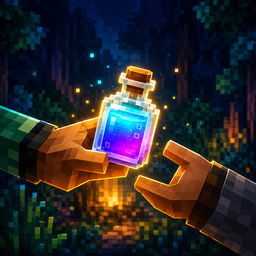

# Let Your Friend Drink

Let Your Friend Drink is a NeoForge add-on for [Let Your Friend Eating](https://www.curseforge.com/minecraft/mc-mods/letyourfriendeating). Right-click another player with a drink-animation item to let that player complete the item's native drinking behavior.

## Behavior

- Handles items whose use animation is `DRINK` before the base mod's ordinary food path.
- Runs `finishUsingItem` as the recipient, so native effects, criteria and item-specific completion logic belong to the player who drinks.
- Uses Let Your Friend Eating's cooldown and feeding statistics.
- Returns bottles and other remainder items to the feeder, matching the base mod's bowl and bucket ownership.
- Preserves the held item when the feeder is in creative mode or when the item is natively reusable.
- Leaves milk buckets to Let Your Friend Eating's existing special-item implementation.

A non-cancelable `FriendDrinkCompletedEvent` is posted on `NeoForge.EVENT_BUS` after the drink and inventory transfer are committed. Compatibility mods can observe this event without replacing drink detection or completion.

## Requirements

- Minecraft 1.21.1
- NeoForge 21.1
- Let Your Friend Eating 1.1.4

Both physical sides install the add-on, matching the base mod.

## Scope

This project does not contain No Hunger healing policy, modpack-specific values, or downed/revival behavior.

## License

GPL-3.0-or-later.
