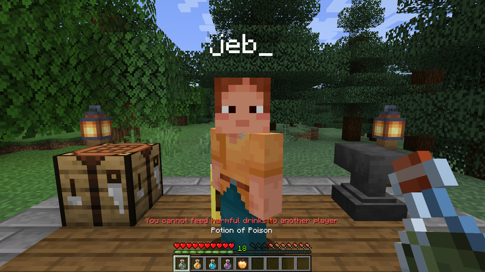
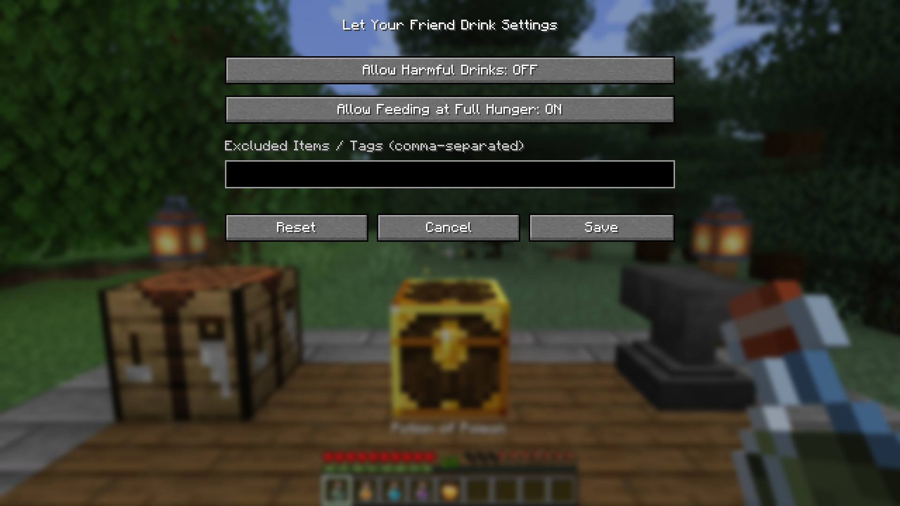

# Let Your Friend Drink

<p align="center">
  
</p>

An addon for **[Let Your Friend Eating](https://modrinth.com/mod/let-your-friend-eating)** that lets you share potions, honey bottles, and modded drinks with other players — plus feed buff foods like Golden Apples even when your friend's hunger bar is already full.



## Features

- **Share potions & modded drinks**: Right-click a friend to feed them vanilla potions, honey bottles, and drinks from other mods using *Let Your Friend Eating*'s normal interaction and cooldowns, returning empty bottles to you afterward.
- **Blocks harmful drinks by default**: Prevents players from force-feeding Poison, Instant Damage, Weakness, Ominous Bottles, or harmful Suspicious Stews (`allowHarmfulDrinks = false` by default). Turn `allowHarmfulDrinks = true` on if you want friendly pranks enabled.
- **Feed buff foods at full hunger**: Lets you feed Golden Apples and modded buff meals through *Let Your Friend Eating* even when your teammate's hunger bar is full (`allowFeedingAtFullHunger = true`).
- **Blacklist support**: Exclude specific item IDs (`"minecraft:ominous_bottle"`) or item tags (`"#c:drinks"`) in `config/let_your_friend_drink.toml`, or with the `#let_your_friend_drink:excluded` datapack tag.



## Configuration

Edit in-game via **Mod Menu** (Fabric) or **Mods → Config** (Forge / NeoForge), or edit `config/let_your_friend_drink.toml`:

```toml
[general]
allowHarmfulDrinks = false
allowFeedingAtFullHunger = true
excludedItems = []
```

## Requirements

Requires **[Let Your Friend Eating](https://modrinth.com/mod/let-your-friend-eating)**.
