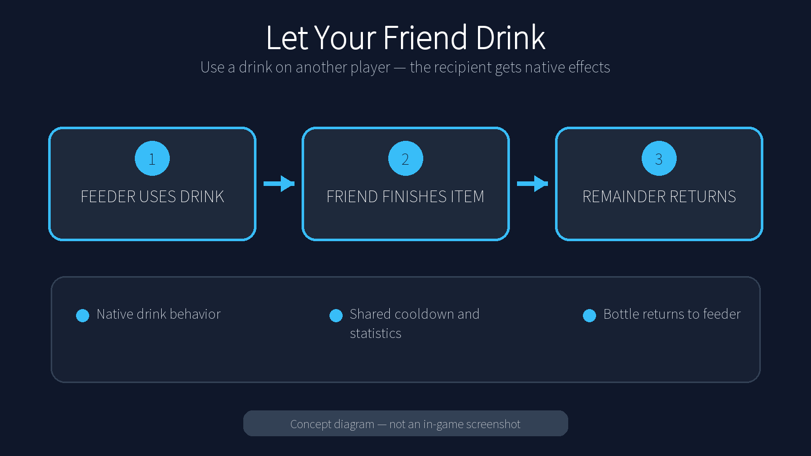

# Let Your Friend Drink

<!-- PROJECT_PAGE_START -->
Use a supported drink on another player: the recipient gets the drink's normal effects, while cooldowns, statistics and the empty container are handled correctly.

## How it works

1. Hold a supported drink and use it on another player.
2. After the normal use duration, the target consumes the item through Minecraft's native item-finish path.
3. The feeder receives the remainder, such as an empty bottle, and normal cooldown/stat behavior applies.

## Safety and compatibility

- Works only when the interaction is valid and neither player is a spectator.
- Re-checks distance and state before completion.
- Supports the Fabric, Forge and NeoForge versions listed on the platform Versions page.
- RinLib is required; Fabric builds also require Fabric API.

## Download and support

Use the platform Versions page for exact game-version and loader files. Report reproducible problems through the project GitHub Issues page.
<!-- PROJECT_PAGE_END -->

---

## Additional technical details

## Behavior

- Handles items whose use animation is `DRINK` before the base mod's ordinary food path.
- Runs `finishUsingItem` as the recipient, so native effects, criteria and item-specific completion logic belong to the player who drinks.
- Uses Let Your Friend Eating's cooldown and feeding statistics.
- Returns bottles and other remainder items to the feeder, matching the base mod's bowl and bucket ownership.
- Preserves the held item when the feeder is in creative mode or when the item is natively reusable.
- Leaves milk buckets to Let Your Friend Eating's existing special-item implementation.

Compatibility add-ons can register a namespaced listener through `FriendDrinkCompletedEvents.register(...)`. Listeners run after the drink and inventory transfer are committed; one failing listener cannot undo the completed drink or prevent other listeners.

## Supported targets

| Minecraft | Fabric | NeoForge |
|---|---:|---:|
| 1.21.1 | Yes | Yes |
| 26.1.2 | Yes | Yes |
| 26.2 | Yes | Yes |

Each artifact declares the matching Let Your Friend Eating release as a required dependency. Both physical sides install the add-on, matching the base mod.

## Scope

This project does not contain No Hunger healing policy, modpack-specific values, or downed/revival behavior.

## License

GPL-3.0-or-later.
